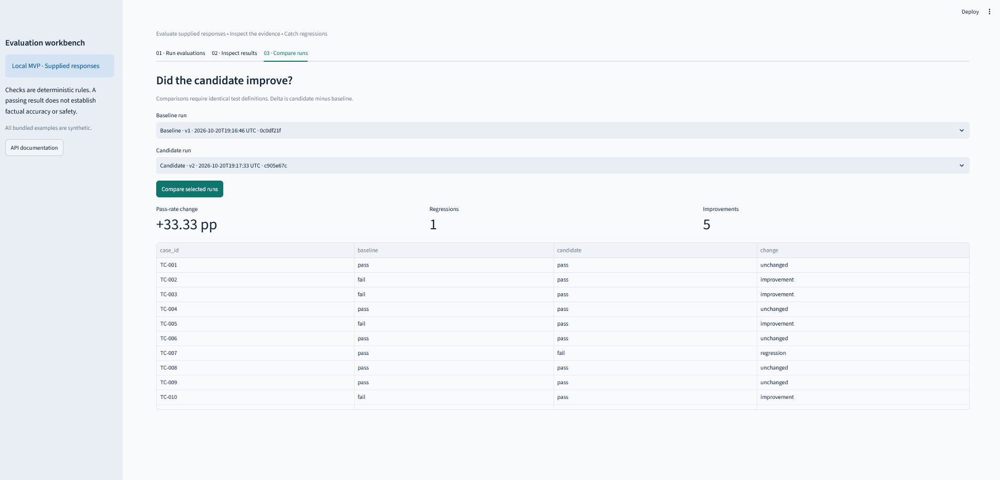
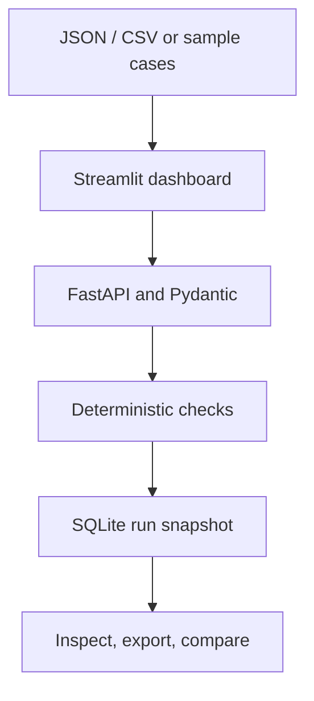

# EvalForge

**Know how your AI actually performs.**

I built EvalForge to make changes in AI responses easier to inspect. It takes responses I already have, runs the same deterministic checks across versions, saves the evidence for each case, and shows where a candidate improved or regressed. It is a local evaluation workbench, not a model provider or an automated judge of meaning.



**Stack:** Python · FastAPI · Pydantic · SQLite · Streamlit · pytest

## What it does

- Imports supplied responses from JSON or CSV, with up to 500 cases per run.
- Checks exact text, required text, forbidden text, or whether a response parses as JSON.
- Saves a complete run snapshot: test definitions, supplied responses, check results, evidence, timestamps, and evaluator version.
- Lets me inspect failed cases, filter results, and export a run as JSON.
- Compares runs only when case IDs, prompts, checks, and evaluator version match. A changed test cannot be mistaken for a model improvement.
- Keeps the original manually labeled evaluation endpoints separate from computed workbench runs.

No API key or paid service is needed. EvalForge **does not generate responses** or call an LLM. I supply the responses to evaluate.

## See the comparison in three minutes

1. Start the API and dashboard using the instructions below.
2. On **Run evaluations**, choose **Sample baseline**. Name it `Baseline`, set version `v1`, and select **Evaluate and save**.
3. Choose **Sample candidate**. Name it `Candidate`, set version `v2`, and save it.
4. On **Inspect results**, open either run to see the original response and the result of each check.
5. On **Compare runs**, select the baseline and candidate, then select **Compare selected runs**.

The bundled synthetic example moves from **7/12 cases passing (58.33%)** to **11/12 (91.67%)**, a **33.33 percentage-point** increase. It records **five improvements and one regression**: case `TC-007` loses the required support address. A better overall score can still hide a behavior worth fixing. The baseline and candidate files are in [`data/`](data/).

## Run locally

Use Python 3.12 or 3.13. Clone the repository, then run these commands from its root.

### Windows PowerShell

```powershell
py -m venv .venv
.\.venv\Scripts\python.exe -m pip install -r requirements.txt
.\.venv\Scripts\python.exe -m pytest -q
.\.venv\Scripts\python.exe -m uvicorn main:app --reload
```

Keep the API terminal open. In a second PowerShell terminal, from the repository root:

```powershell
.\.venv\Scripts\python.exe -m streamlit run dashboard.py
```

### macOS / Linux

```bash
python3 -m venv .venv
source .venv/bin/activate
python -m pip install -r requirements.txt
python -m pytest -q
python -m uvicorn main:app --reload
```

Keep the API terminal open. In a second terminal, activate the same environment and run:

```bash
source .venv/bin/activate
python -m streamlit run dashboard.py
```

Open the dashboard at **http://localhost:8501**. FastAPI's interactive API documentation is at **http://127.0.0.1:8000/docs**. The API owns database access; the dashboard talks to it over HTTP. Saved runs remain available after a restart.

The default database is `evaluations.db` in the repository directory. It is created locally and excluded from Git. Optional shell variables are shown in [`.env.example`](.env.example): `EVALFORGE_DB` changes the database path and `EVALFORGE_API_URL` changes the dashboard's API address. The application does not automatically load `.env.example` or a `.env` file.

## Import a dataset

The dashboard accepts a UTF-8 JSON array or a CSV file of at most 5 MB and 500 cases. Each case needs a unique `case_id`, a `prompt`, a supplied `response`, and at least one check. The sample JSON and CSV files in [`data/`](data/) are templates.

```json
[
  {
    "case_id": "TC-001",
    "prompt": "Reply with exactly hello.",
    "response": "Hello",
    "checks": [
      {"kind": "exact_match", "value": "hello", "case_sensitive": false}
    ]
  }
]
```

For CSV, the columns must appear in this order: `case_id,prompt,response,checks`. The `checks` cell contains a properly quoted JSON array.

| Check | What it tests |
| --- | --- |
| `exact_match` | The whole response matches the expected text after trimming outer whitespace. |
| `contains` | The response includes the required substring. |
| `not_contains` | The response excludes the forbidden substring. |
| `valid_json` | The response parses as JSON; it does not validate a schema or meaning. |

Text checks are case-insensitive by default; set `case_sensitive: true` when needed. Every check must pass for a case to pass. A case's fractional score is its number of passing checks divided by its total checks; a run's pass rate counts only fully passing cases. For `valid_json`, omit `value` or use an empty string.

## Architecture



`dashboard.py` handles upload, evidence review, and comparisons. `main.py` exposes the API. `workbench.py` validates datasets, evaluates responses, saves runs, and compares them. `database.py` retains the original manual-evaluation records. A run is saved in one SQLite transaction. Comparisons require matching test definitions and evaluator versions; response text and case order can differ.

| Method | Route | Purpose |
| --- | --- | --- |
| `GET` | `/health` | Process health |
| `POST`, `GET` | `/runs` | Save or list computed runs |
| `GET` | `/runs/{run_id}` | Retrieve a complete run |
| `GET` | `/compare?baseline_id=…&candidate_id=…` | Compare compatible runs |
| `POST`, `GET` | `/evaluations` | Create or list original manual labels |
| `GET` | `/summary` | Summarize original manual labels |

Unknown run IDs return 404, invalid inputs or incompatible comparisons return 422, and database errors return 503. The manual-label summary does not combine with computed run metrics.

## Tests and limits

The test suite covers input validation, the check rules, persistence, comparison safeguards, API errors, and a Streamlit-to-API workflow. The original seven service tests remain part of the **36-test** suite. Run it with `python -m pytest -q`. [GitHub Actions](.github/workflows/tests.yml) runs it on Python 3.12 and 3.13; the [latest verified workflow run](https://github.com/Roidneg/EvalForge/actions/runs/39484289588) passed on both versions on October 20, 2026.

Deterministic string and syntax checks are repeatable but shallow. A passing substring check does not prove a factual claim is true or safe; a forbidden substring can fail even when the response negates the phrase. This local MVP has no live model integration, authentication, background queue, or public deployment. SQLite stores supplied responses in plaintext, so use synthetic or approved data and keep the servers local. Public hosting would require access controls, request limits, and other operational work.

## How I built it

EvalForge grew from my original AI Evaluation Service. I set the evaluation workflow and sample comparison, tested the application, and reviewed where the checks could mislead. I used AI coding assistance to implement and refine the system. The design reflects a lesson from my AI trust work: an aggregate improvement is useful, but I still need the case-level evidence and a clear account of what the checks cannot establish.

More development context is in [`docs/SESSION_NOTES.md`](docs/SESSION_NOTES.md); its October 20 checkpoint predates the repository publication and successful hosted CI run.

